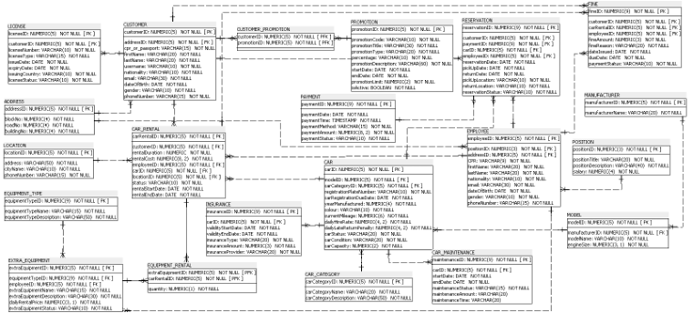

# Car Rental Database

An Oracle SQL and PL/SQL group coursework project for **IT7005 — Database 2**. It models how a car rental company manages its fleet, customer reservations, rentals, and payments.

## Entity Relationship Diagram

*Click the diagram to view it at full size.*

## What the Database Covers

| Area | Records modeled |
| --- | --- |
| Customers and bookings | Customer profiles, driving licenses, reservations, and rental agreements |
| Fleet and operations | Vehicles, models, manufacturers, categories, rental locations, insurance, and maintenance |
| Payments and extras | Payments, fines, promotions, and optional rental equipment |
| Staffing | Employees and job positions |

## SQL and PL/SQL Features

- **Schema and sample data:** Tables, primary and foreign keys, constraints, and sample records.
- **Sequences and triggers:** Generate record IDs and enforce rental rules, including vehicle availability and license expiry checks.
- **Reporting views:** Summarize popular vehicles and monthly rentals by location.
- **Indexes and permissions:** Demonstrate indexed lookups and database account privileges.

## Project Files

- [car_rental_database.sql](car_rental_database.sql) — Oracle schema, sample data, triggers, reporting views, indexes, and permissions.
- [car-rental-erd.png](car-rental-erd.png) — Visual reference for the database structure.

## Run Locally

Review the script before running it in Oracle SQL Developer or another Oracle SQL client. Use a separate practice schema: the script begins by dropping existing tables and sequences with the same names. Review the account creation and privilege statements separately, as they require appropriate Oracle permissions.
